# 中式八球 UI / UX V2.4

2026-11-08 · 已确认V8球桌模型规范

低位、高位、摆球与打点图用于说明交互布局。V8实际渲染与参数见T01、T09-T12。

## 低位瞄准

母球后方的近距离观察位置。

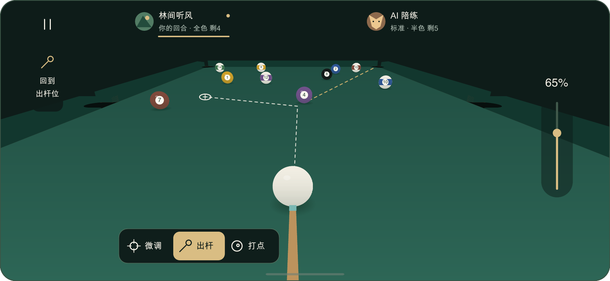

### 共同界面

上沿身份、左侧暂停与回到出杆位、右侧力度、下沿操作条固定。

### 手势分工

单指拖动调球杆方向。双指同向移动环绕、抬高镜头，捏合改变远近。

### 回位语义

回到出杆位只调整镜头。方向、力度与确认打点分别保存。

## 高位全局观察

同一镜头抬高、环绕并拉远后的示意状态。

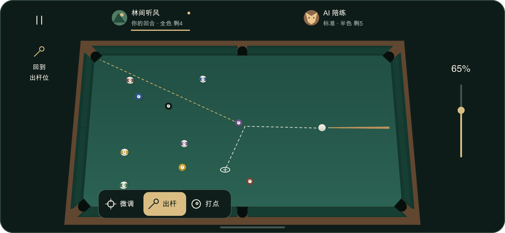

### 连续观察

高低机位之间连续变化。完整六袋可进入画面，球与袋口始终遵守同一空间比例。

### 同一HUD

身份、力度与三个操作的坐标、尺寸和样式与低机位一致。当前球杆方向与轨迹随场景投影。

### 参数独立

环绕后继续按当前球杆方向出杆。回位可重新从母球后方确认击球方向。

## 统一界面内摆球

推荐较高机位进入，用户仍可主动环绕、抬高和缩放。

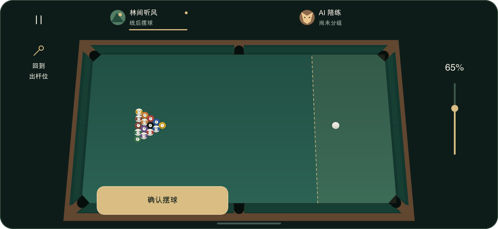

### 手势归属

单指轻触或拖动编辑母球，双指调整镜头。第二指加入时保留最近合法球位并建立观察起点。

### 确认动作

操作条替换为确认摆球。重叠、袋口或越界时保留合法位置并提示原因，确认按钮仅在合法时可用。

### 确认之后

保留当前镜头，进入正常瞄准。用户可点击回到出杆位，或继续在当前角度观察和瞄准。

## 打点编辑与自由观察

面板编辑草稿，场景区域支持双指观察。

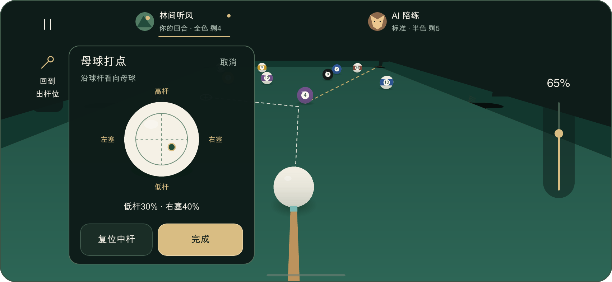

### 方向定义

沿球杆看向母球定义高低杆和左右塞，读数保持该方向定义。

### 编辑与恢复

完成应用、取消恢复原值，复位仍需确认。面板外单指瞄准暂停，双指观察可用。

### 面板归属

图示为左侧258×304面板。默认左右分工待评审，所有机位共用同一布局。

## 手势与观察规则

### 单指瞄准

使用相对拖动调整球杆方位，可抬手续拖。镜头保持当前观察位置，球杆与预测线反馈实际方向。

### 双指观察

同向平移调整方位与俯角，捏合调整远近。达到识别阈值后锁定主意图，灵敏度与阈值由交互原型校准。

### 手指数变化

第二指加入时结束单指编辑并重新建立手势起点。双指退为单指后等待全部抬起再接受新的单指编辑。

### 控件优先

控件内起始触摸由该控件独占。双指观察要求两指都起始于场景。面板、力度和按钮保留各自命中范围。

### 取消恢复

取消保存最近有效参数。窗口尺寸变化结束旧手势并继续对局，暂停和后台恢复需要明确继续。

## 组件与视觉规范

### 参考布局

852×393逻辑像素。身份条148×44，暂停44×44，回到出杆位44×88，力度44×144，操作条224×48。

### 操作条

三项触区72×44，图标18、标签12，水平图文排列。出杆72×40金色表面，圆角9，操作条圆角12。打点位于出杆右侧。

### 文字与颜色

标题18-24、动作12、正文14、身份12/10、力度16。背景#0E1C19、面板#1C3028、主字#F4F0E6、次字#ABBAB0、强调#D9BD83。

### 图标与状态

1.5px圆端点线框。行动方使用文字与金色短线，禁用保留可读标签，按下反馈与布局位置分开处理。

### 微调与打点

微调条展开在操作条上方，范围±5°、步长0.1°。打点面板258×304，球面104、选择半径36，球面编辑触区至少144×144。

## 镜头、回位与遮挡

### 自由观察范围

镜头围绕球台移动并保持台面上方。通过距离与局部遮挡处理提供母球、杆头和目标的观察路径。俯角和缩放边界由原型校准。

### 回位和打断

沿当前球杆方向回到母球后方，新的观察手势可以打断回位并连续接管。准备与运动阶段使用该杆起点，结算后回位使用当前母球。

### 信息简化

简洁显示、左右布局与帮助位于暂停菜单。简洁状态保留行动方、球组、力度、暂停、回位与必要阶段操作。

### 轨迹和球体

白虚线表示母球，金虚线表示目标球。轨迹、球号、连续半色环带与阴影遵循同一场景投影和遮挡关系。

### 关键区域

保护母球、杆头、首碰点、当前目标袋口与轨迹。参考保护边距20/12逻辑像素，连续按下期间控件固定。

## 出杆时序与恢复

### 0-220ms

0-140ms图标球杆后收，140-220ms前送。准备开始锁定方向、力度和确认打点，期间允许自由观察。

### 220ms关键帧

按钮触球、母球启动和击球音效同帧发生，提交次数为一次。

### 220-820ms

220-480ms反馈短线扩散并让球离场，480-640ms留杆，640-820ms图标复位。

### 中断规则

触球前取消准备，人类恢复后重新点击。AI沿用锁定命令重新准备。触球后继续原杆。低帧率按事件顺序与提交次数验收。

### 减少动态

简化回位动画和位移动效，保留触球同步。镜头转场的速度与舒适性需要交互验证。

## 响应与完整流程

### 横屏适配

检查667×375、852×393、932×430及平板。按实际系统和宿主安全区排布，所有互动目标至少44，字号保持可读。

### 开始与暂停

开始选择玩法和AI难度。暂停集中继续、设置、难度、规则、判罚、布局和重开。重开提供二次确认。

### 阶段操作

摆球显示确认摆球，选组显示全色/半色，开球处理显示裁判要求的动作。操作区按阶段替换，镜头和身份连续保留。

### 结果与资料

结果显示胜者、原因、再来一局和查看台面。身份详情展示完整昵称，规则和署名分页。五项既有设置即时生效。

### 默认横屏

引擎从入口按横屏启动。窗口变化时重新适配并结束旧手势，保持球局、镜头与参数。后台恢复后明确继续。

## 可验证的完成标准

### C01 统一界面

低位、高位与任意环绕位置的身份、力度、主操作坐标和样式一致。固定入口名为回到出杆位。

### C02 手势隔离

双指环绕与捏合前后，球杆方位、力度和打点值相同。第二指加入与退出均无方向跳变、母球跳位或额外击球。

### C03 摆球

任意可操作观察角度可合法摆球，双指只改变镜头。确认保留镜头，回位保持合法球位。

### C04 跨阶段

AI、准备、运动、打点草稿与结果阶段可观察。运动中回位使用保存的出发点，停稳后保持用户观察位置。

### C05 回归与环境

验证220ms同帧唯一提交、裁判和AI回归、布局避让、窗口适配和后台恢复。文件检查、浏览器、Creator及设备验收分别记录。

## 阶段与权限矩阵

|阶段|可操作范围|确认与恢复|
|---|---|---|
|正常瞄准|单指调方向，双指观察|独立出杆，主动回位|
|摆球|单指放白球，双指观察|合法确认，保留镜头|
|选组/开球处理|双指观察，完成裁判要求|选择完成后允许击球|
|AI回合|双指观察，回位，暂停|人类参数编辑只读|
|准备/球运动|双指观察，回位，暂停|回位使用该杆起点|
|打点草稿|面板编辑，场景双指观察|完成应用，取消恢复|
|窗口/后台|窗口适配保持对局，后台暂停|结束旧手势，后台恢复需继续|
|结果|观察台面，查看判定|再来一局或返回结果|
## 球桌造型规范 V2.4

2026-11-08。执行V8已确认模型。T01/T09/T10/T11为该模型的实际渲染，T12为参数与交付规范。T02-T08中的结构示意用于解释部件关系，具体轮廓与材质以V8模型为准。前四张图用于说明布局与手势。

### T01 已确认整桌造型

V8统一模型渲染 · 2026-11-08用户确认 · 游戏接入待实施。

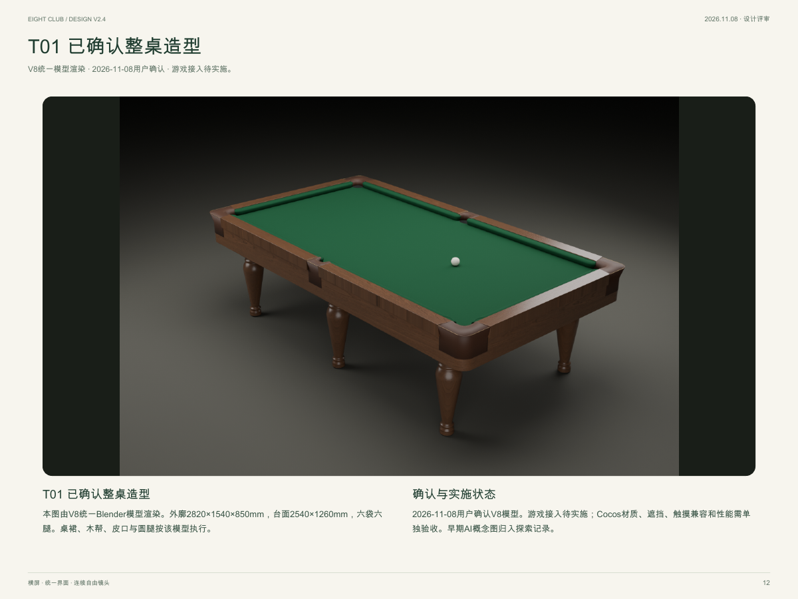

#### T01 已确认整桌造型

本图由V8统一Blender模型渲染。外廓2820×1540×850mm，台面2540×1260mm，六袋六腿。桌裙、木帮、皮口与圆腿按该模型执行。

#### 确认与实施状态

2026-11-08用户确认V8模型。游戏接入待实施；Cocos材质、遮挡、触摸兼容和性能需单独验收。早期AI概念图归入探索记录。

### T02 库边剖面与包布

圆润鼻口、上表面截面变化、木扶手与承托层共同定义低视角形态。

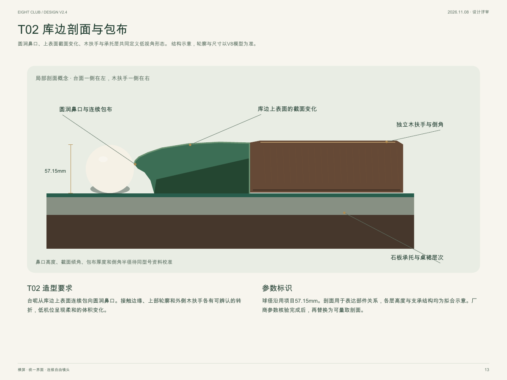

#### T02 造型要求

台呢从库边上表面连续包向圆润鼻口。接触边缘、上部轮廓和外侧木扶手各有可辨认的转折，低机位呈现柔和的体积变化。

#### 参数标识

球径沿用项目57.15mm。剖面用于表达部件关系，各层高度与支承结构均为拟合示意。厂商参数核验完成后，再替换为可量取剖面。

### T03 角袋与中袋的部件关系

两类入口分别研究，净口、皮口外沿与袋内空间分别标注。

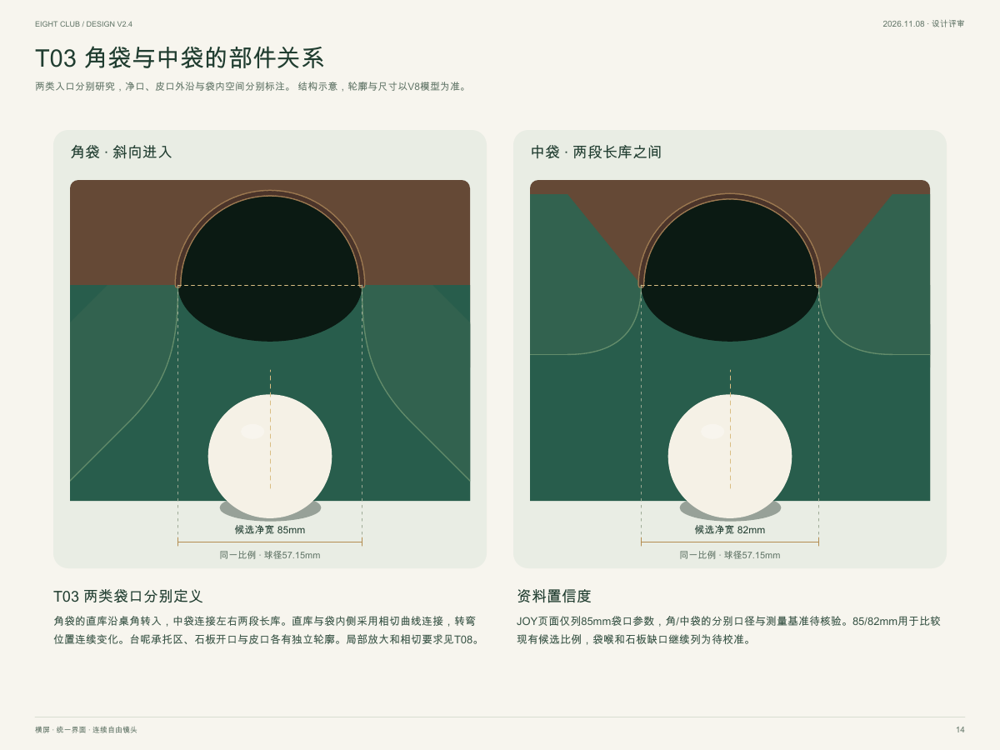

#### T03 两类袋口分别定义

角袋的直库沿桌角转入，中袋连接左右两段长库。直库与袋内侧采用相切曲线连接，转弯位置连续变化。台呢承托区、石板开口与皮口各有独立轮廓。局部放大和相切要求见T08。

#### 资料置信度

JOY页面仅列85mm袋口参数，角/中袋的分别口径与测量基准待核验。85/82mm用于比较现有候选比例，袋喉和石板缺口继续列为待校准。

### T04 进袋下落与空间遮挡

球体进入袋内、连续下沉并被实体遮挡，随后完成本杆结算。

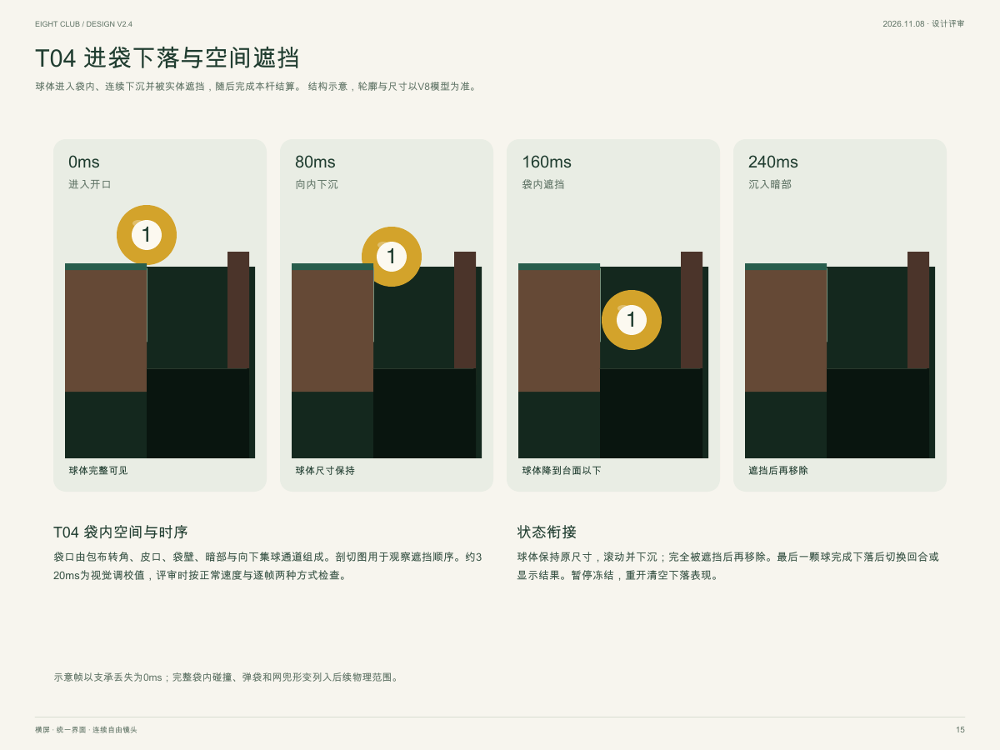

#### T04 袋内空间与时序

袋口由包布转角、皮口、袋壁、暗部与向下集球通道组成。剖切图用于观察遮挡顺序。约320ms为视觉调校值，评审时按正常速度与逐帧两种方式检查。

#### 状态衔接

球体保持原尺寸，滚动并下沉；完全被遮挡后再移除。最后一颗球完成下落后切换回合或显示结果。暂停冻结，重开清空下落表现。

### T05 材质、灯光与落地感

V8实际模型材质近景，木纹、皮口与桌裙使用同一母版。

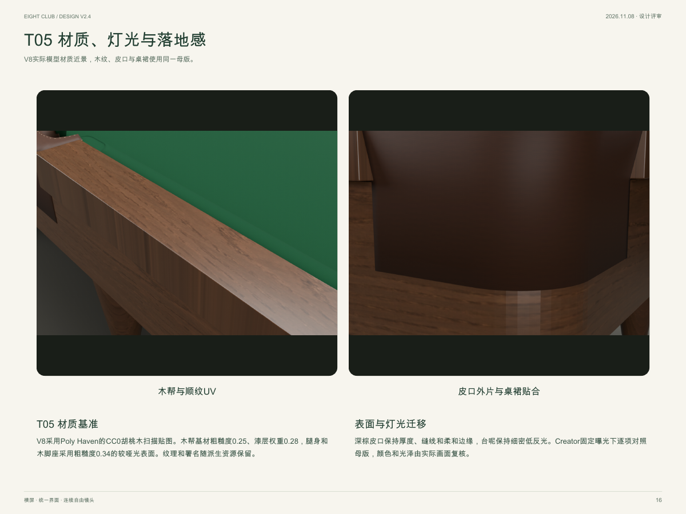

#### T05 材质基准

V8采用Poly Haven的CC0胡桃木扫描贴图。木帮基材粗糙度0.25、漆层权重0.28，腿身和木脚座采用粗糙度0.34的较哑光表面。纹理和署名随派生资源保留。

#### 表面与灯光迁移

深棕皮口保持厚度、缝线和柔和边缘，台呢保持细密低反光。Creator固定曝光下逐项对照母版，颜色和光泽由实际画面复核。

### T06 参数、来源与待校准项

|项目|当前规范|依据与状态|
|---|---|---|
|整桌 / 台面|2820×1540×850 / 2540×1260mm|JOY公开型号数据 [S1]|
|整体边带|对称布置时约140mm|由内外尺寸推算，涵盖多个结构层|
|球体比例|球径57.15mm|沿用本项目比例参照|
|袋口净宽|现有候选角85 / 中82mm|S1仅列85mm，分别口径与测法待核验|
|库边截面|鼻口高34mm / 木面宽95mm|V8造型拟合，实物测量待核验|
|袋内结构|皮革厚3mm / 下落空间185mm|V8造型拟合，完整袋内物理待实施|
|桌体与材质|胡桃木桌裙、车枳圆腿与木脚座|V8已确认，毫米数为游戏造型拟合|

公开来源访问日期2026-11-06。[S1 JOY Q8 Pro](https://www.joybilliard.com/billiards-table/golden-leg-billiards-tables.html)、[S2 腾勃灵霄](https://www.shtengbo.com/proxq.aspx?ID=7)。

S1的袋口85mm未区分角/中袋和测量方法；其石板尺寸字段含46mm与48mm两种表述，当前剖面厚度列为待核验。S2提供部件关系参考。

### T07 造型与体验验收

#### V01 比例

整桌与台面按T06尺寸检查模型包围范围；球径57.15mm。T03两图使用同一比例。约140mm只描述整体边带。

#### V02 低位形态

在母球后方低位、贴长库、贴短库和角袋附近四类机位，各能辨认鼻口、包布与木扶手；转折连续且无硬直绿墙。

#### V03 袋口连续

六袋的高位与低位共12组画面；直库、圆弧袋角与袋内侧相切连接，放大400%时轮廓连续。台呢转角、皮口、木扶手和袋内空间连接完整，无透底、悬空接缝或可见支撑穿过入口。

#### V04 下落与状态

六袋各检查慢速和高速进球；连续帧中球体尺寸保持，下沉后经实体遮挡再移除。最后一球落白和黑8结果需完成下落再切换；暂停冻结，重开清空。

#### V05 材质与镜头

T01高位、母球后低位、角袋和中袋特写四张样板使用同一光照；布、木、皮、金属可辨。绕台与拉远时桌体、桌腿和地面阴影连续呈现。

### T08 圆润袋角与相切连接

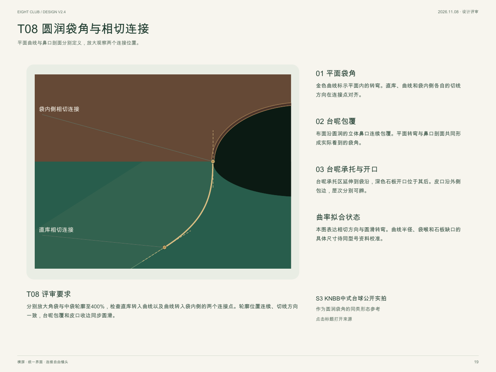

#### 01 平面袋角

金色曲线标示平面内的转弯。直库、曲线和袋内侧各自的切线方向在连接点对齐。

#### 02 台呢包覆

布面沿圆润的立体鼻口连续包覆。平面转弯与鼻口剖面共同形成实际看到的袋角。

#### 03 台呢承托与开口

台呢承托区延伸到袋沿，深色石板开口位于其后。皮口沿外侧包边，层次分别可辨。

#### 曲率拟合状态

本图表达相切方向与圆滑转弯。曲线半径、袋喉和石板缺口的具体尺寸待同型号资料校准。

#### T08 评审要求

分别放大角袋与中袋轮廓至400%，检查直库转入曲线以及曲线转入袋内侧的两个连接点。轮廓位置连续、切线方向一致，台呢包覆和皮口收边同步圆滑。

圆润袋角的同类实拍形态参考。[S3 KNBB中式台球介绍与照片](https://www.knbb.nl/chinese-pool-komt-naar-nederland/)。照片中的圆弧与包布关系用于形态研究，具体尺寸待同型号核验。

### T09 V8低位模型观察

与T01使用同一模型、材质与比例参照。

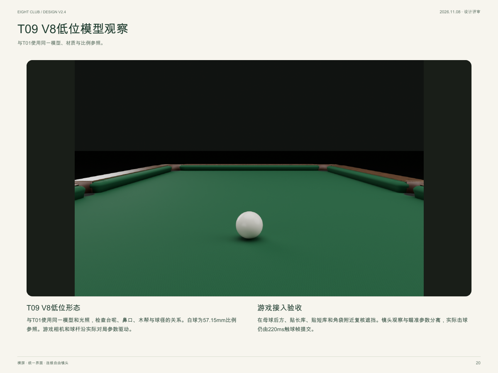

#### T09 V8低位形态

与T01使用同一模型和光照，检查台呢、鼻口、木帮与球径的关系。白球为57.15mm比例参照。游戏相机和球杆沿实际对局参数驱动。

#### 游戏接入验收

在母球后方、贴长库、贴短库和角袋附近复核遮挡。镜头观察与瞄准参数分离，实际击球仍由220ms触球帧提交。

### T10 V8角袋与中袋

实际模型近景 · 袋角、皮口与袋壁的连接依据。

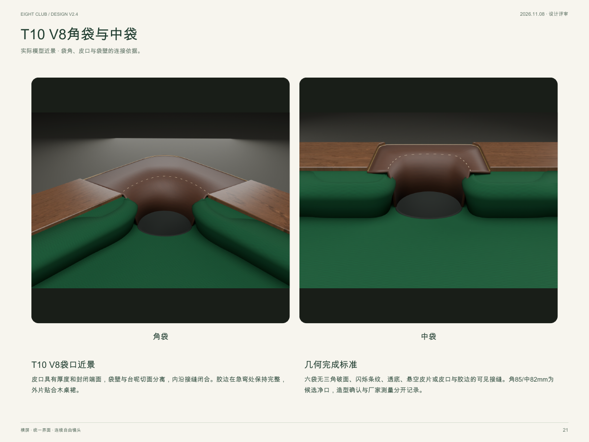

#### T10 V8袋口近景

皮口具有厚度和封闭端面，袋壁与台呢切面分离，内沿接缝闭合。胶边在急弯处保持完整，外片贴合木桌裙。

#### 几何完成标准

六袋无三角破面、闪烁条纹、透底、悬空皮片或皮口与胶边的可见接缝。角85/中82mm为候选净口，造型确认与厂家测量分开记录。

### T11 已确认桌腿造型

正交轮廓与整桌近景共同约束造型。

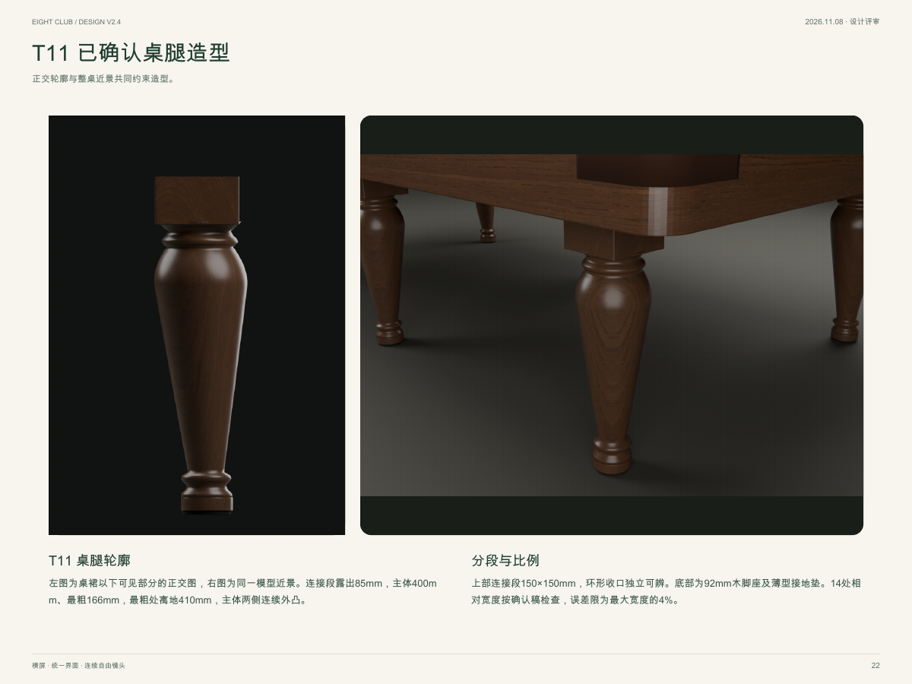

#### T11 桌腿轮廓

左图为桌裙以下可见部分的正交图，右图为同一模型近景。连接段露出85mm，主体400mm、最粗166mm，最粗处离地410mm，主体两侧连续外凸。

#### 分段与比例

上部连接段150×150mm，环形收口独立可辨。底部为92mm木脚座及薄型接地垫。14处相对宽度按确认稿检查，误差限为最大宽度的4%。

### T12 模型参数与交付边界

造型基准已确认，游戏接入与实物测量分别验收。

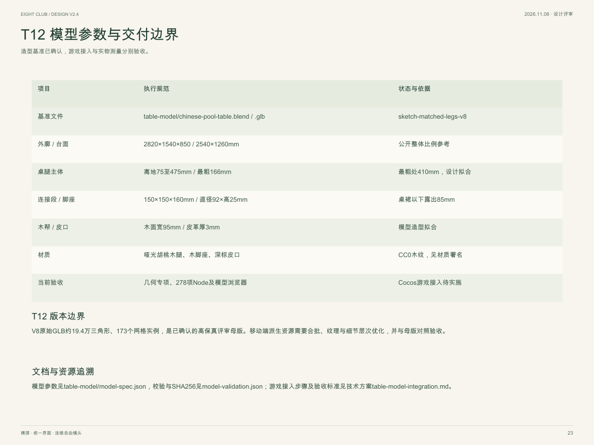

#### T12 版本边界

V8原始GLB约19.4万三角形、173个网格实例，是已确认的高保真评审母版。移动端派生资源需要合批、纹理与细节层次优化，并与母版对照验收。

#### 文档与资源追溯

模型参数见table-model/model-spec.json，校验与SHA256见model-validation.json；游戏接入步骤及验收标准见技术方案table-model-integration.md。

### 模型交付与状态

V8统一Blender母版和GLB、参数、材质署名及文件指纹均已交付。T01、T09至T11为实际模型渲染，T12记录执行参数和资源状态。T02至T08中的结构示意继续解释部件关系，具体形态以V8为准。游戏接入、Creator和设备结果按技术方案单独验收。

