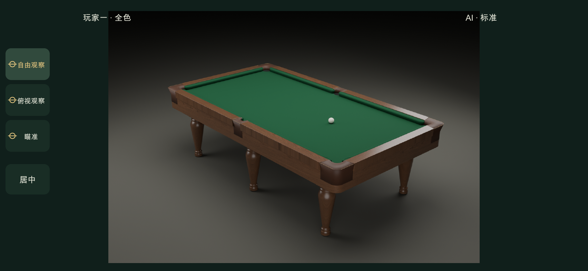
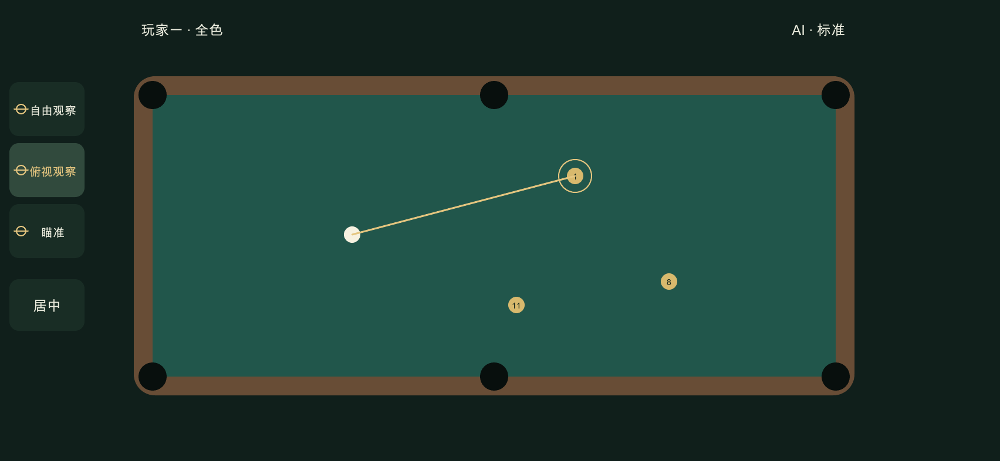
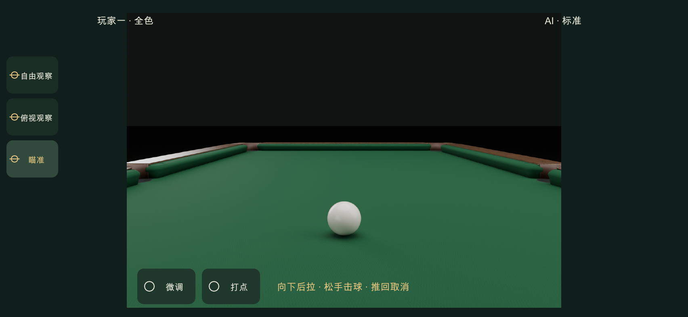
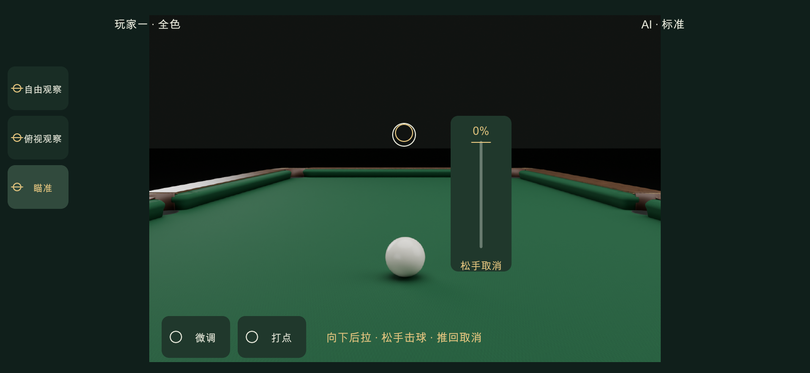

# 中式八球 UI / UX设计 3.0

2026-11-09 · 三状态操作与后拉出杆

## 三状态触摸操作

已批准的移动端横屏交互，版本3.0

### 自由观察

轻点台面在松手时瞄准触点，球杆朝向同步更新，单指拖动围绕锚点环绕，双指同向拖动同步平移相机与锚点，捏合调整距离。锚点沿台面移动并有边界，居中球桌恢复完整桌面。

### 俯视观察

正交镜头垂直台面，长边横向展示。单指按下立即朝台面触点瞄准，移动持续跟随，抬手保留方向。双指平移、缩放。

### 瞄准

镜头移至母球后方。横向相对拖动调角，慢拖低灵敏度。向下后拉蓄力，松手击球，推回零点取消。轻点保持方向。

### 进入与切换

开局摆球从俯视进入，确认后俯视选线路。后续保留主模式，瞄准时重定位至新母球。模式切换清除当前手势，240ms镜头过渡，可减少动态。

## 一杆操作与参数

观察、确定方向、后拉与触球构成连续流程

### 后拉出杆

瞄准方向、打点确认后，向下拉增加力度。力度0%至100%，满力行程96逻辑像素，前段更细。回推至4px零点容差内为0%。

### 边缘起手

底部剩余空间不足96px时提示向上移一点再后拉。尚未蓄力时允许上移重设零点，具备行程后可后拉。

### 微调与打点

微调支持连续低灵敏度拖动、抬手续拖和0.1度步进。打点使用草稿、确认、取消与回中，按钮回显确认值。

### 实际触球

松手启动100至160ms前送，杆头接触母球同帧提交物理并播放声音。之后短距离送杆、淡出。AI沿用独立的自动出杆入口。

## 权限、取消与验收

比赛阶段决定编辑权限，观察模式始终可辨认

### 双指与取消

第二指加入取消蓄力，俯视恢复单指按下前方向，进入双指观察。手指数减少等待全部抬起。暂停、后台、窗口变化、系统取消清除手势。

### 摆球与比赛

摆球时单指编辑母球，双指平移缩放，自由观察可检查位置。AI、球运动与结果查看提供观察权限，球停稳且裁判允许后恢复方向编辑。

### 反馈与可用性

三模式常驻选中反馈，触区至少44px。锚点20px操作后600ms淡出，俯视触点300ms淡出。力度仅蓄力时显示，底部保留微调和打点。

### 验收

覆盖三横屏667×375、852×393、932×430与DPR2/3。检查触点方向、模式隔离、双指恢复、蓄力零点、边缘重设、唯一触球、AI和裁判回归。真实设备及微信专项按既有约定跳过。

## 输入判定与反馈

所有距离均为逻辑像素，首轮参数待手感校准

### 起手方向

自由观察小于8px的轻点在松手时瞄准，拖动越过8px后仅环绕。瞄准状态8px后识别，横向超过纵向1.3倍进入调角，向下超过横向1.3倍进入后拉。模糊斜向继续等待，识别后固定用途。

### 双指意图

中心累计移动6px或指距变化4%进入识别，以归一化幅度更大者判定。平移与缩放各自锁定，全部抬起重新识别。

### 提示与零点

俯视触点空心圆环，锚点十字圆环。蓄力显示百分比与零点，零力度显示松手取消。底部无行程时显示向上移一点再后拉。

### 中断

触摸取消、第二指、模式切换、暂停、后台与尺寸变化取消蓄力。前送触球前暂停取消，触球后冻结原杆并在继续时恢复。

## 模式、阶段与布局

主状态与临时控件分开表达

### 布局

左侧3项模式控件，每项至少44px。观察时显示居中球桌，瞄准时底部显示微调与打点两个线框按钮，身份卡位于顶部两侧。

### 权限

俯视单指仅在合法可瞄准阶段编辑方向。摆球单指移动母球。AI、球运动、结果查看可自由或俯视观察。运动时进入瞄准显示只读提示。

### 镜头记忆

自由与俯视分别记忆目标和距离。进入瞄准沿当前方向回母球后方，下一杆瞄准以新母球重新就位，观察模式保留视角。

### 微调与面板

微调条相对拖动并显示相对角度，可续拖超过原±5度窗口。打点面板确认后回显，面板外台面作为背景，关闭后开始新手势。

## 运动与一致性验收

以真实触球时刻作为唯一提交边界

### 后拉与前送

拉力使用零点后4px死区，96px满力，幂曲线1.6。台面杆后移最多180mm，前送100加60乘力度比例毫秒，触球后80ms送杆，再80ms淡出。

### 保护触摸

方向拖动、蓄力和双指观察均有独立所有权。俯视第二指恢复方向快照，取消后无残余角度、力度或额外击球。

### 验证图稿

三张模式图为设计图，球桌真实材质与轮廓依照V8模型章节。运行截图及自动检查报告另存技术验收目录。

### 回归范围

测试纯手势、镜头、ShotSequence与组件入口，构建Creator Web Mobile，浏览器多画幅合成DOM触摸，工程预览运行核验。

## 自由观察图稿

## 俯视观察图稿

## 瞄准准备图稿

## 后拉蓄力反馈图稿

## 归零取消反馈图稿

## V8球桌规范

采用已批准V8模型与资源契约，外廓2820×1540×850mm、台面2540×1260mm、球径57.15mm。六条车枳圆腿主体400mm、最粗166mm，脚座92mm。模型与材质细节见[模型规范](table-model/README.md)。
