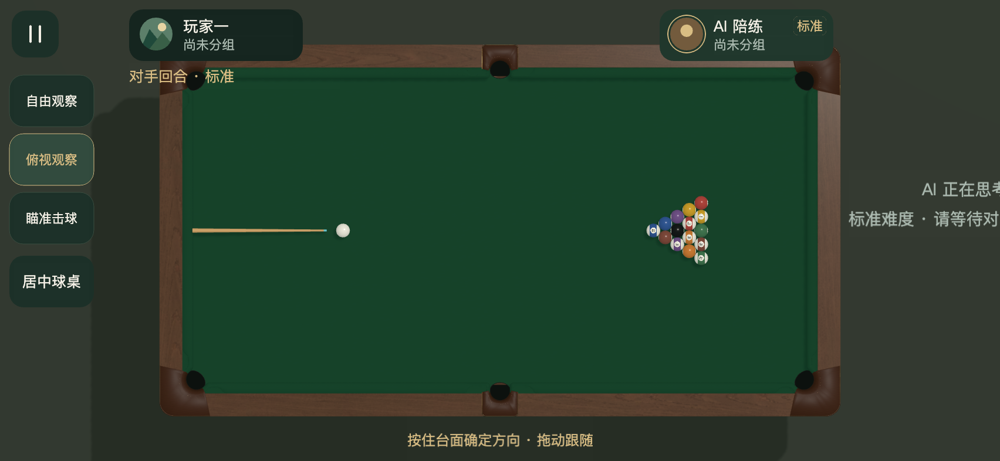
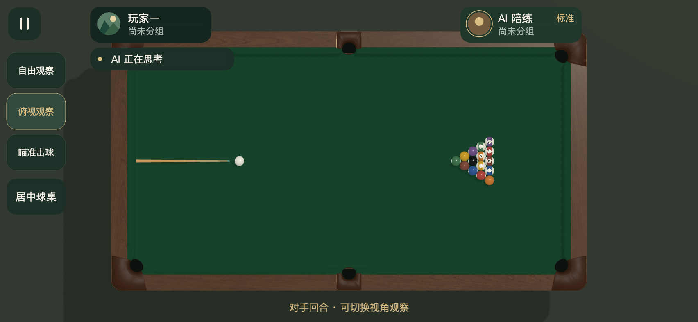
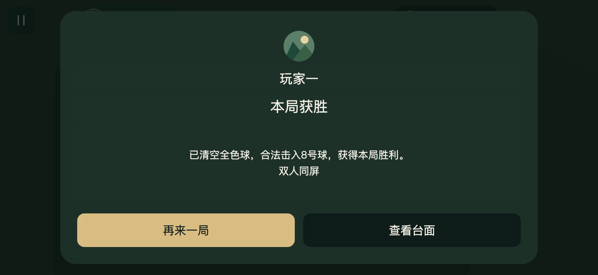

# AI状态提示与结算身份居中

2026-11-09。AI等待文案原来复用了右侧44px力度区，文本默认自适应宽度，导致内容越过屏幕边缘。现在顶部回合区显示176×28单行状态条，文字12px、可用宽140px，难度独立显示在AI身份卡。最长状态文案实测约111px，思考、摆球、处理开球结果、瞄准、准备击球与球运动均完整可见。暂停、弹窗及人类回合隐藏该状态条。

结算参照已批准的docs/design/refinement/result.png居中层级，采用头像、昵称、获胜标题纵向同轴排列。头像几何中心和昵称Label均居中，三个昵称长度的真实渲染检查通过。紧凑高度采用较小间距，正文与底部按钮保持独立。

296项Node和Creator Web Mobile构建通过，四种横屏568×320、667×375、852×393、932×430各43项检查通过，工程预览另43项，错误捕获为0。实际Canvas字体测量验证文字宽度，Graphics轮廓验证头像居中，UI矩形验证正文、昵称、标题和按钮互不重叠。另有52项完整触摸及21项结算操作/辅助线回归通过。

AI状态通过延迟计划启动的受控场景固定，准备击球及球运动由实际出杆时间线触发，结算使用受控胜者与昵称。真实设备及微信按既有用户约定跳过。复验脚本为scripts/preview-ai-status.js。

