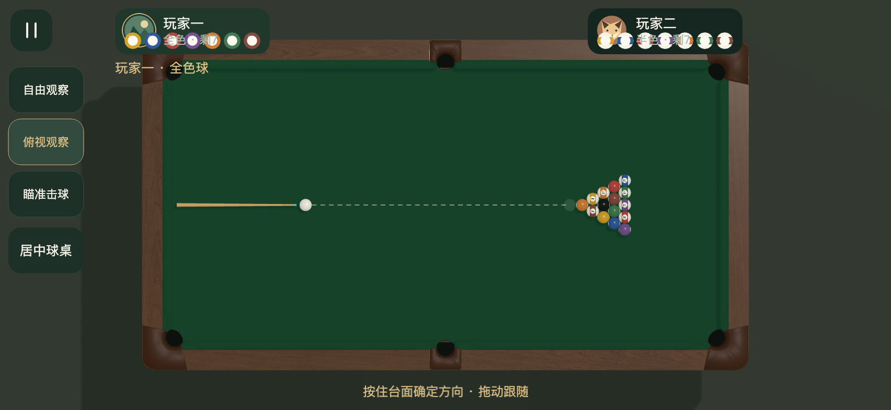
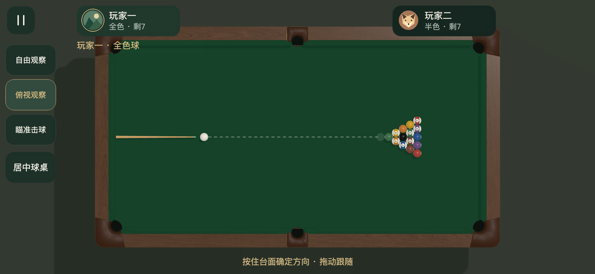

# 玩家卡片球图重叠修正

2026-11-09。紧凑卡片已隐藏号码Label，但Graphics仍绘制彩球，导致球图覆盖球组文字和头像。现在球图与号码使用同一显示条件，隐藏Label同时跳过图形绘制。

当前横屏148×44卡片展示头像、昵称、球组与剩余数，点击资料可查看完整球号。高度达到64逻辑像素的卡片保留独立底部球号行，零球时显示目标8号提示。44/56高度收起整行，避免紧凑尺寸仍绘制球图。

296项Node、Creator Web Mobile构建通过。三种横屏和工程预览各388项实际卡片渲染检查通过，覆盖134.5/148/171宽度、44/56/64/74高度、全色与半色、1/7颗球、本地与AI难度、长昵称。检查图形路径数量、球号行与文字分离、完整行边界及DOM点卡片后七球资料可见。真实设备及微信按用户约定跳过。

复验脚本为scripts/preview-player-cards.js。

