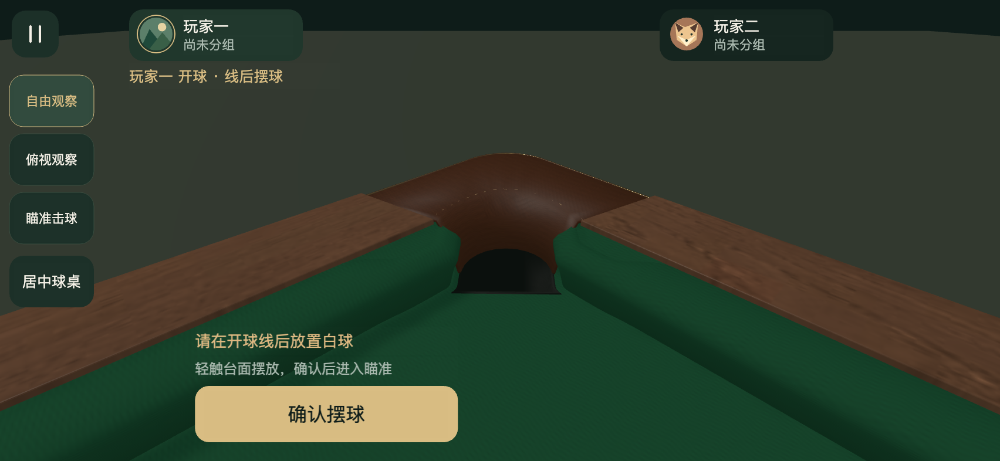
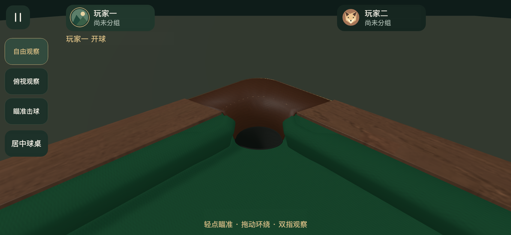
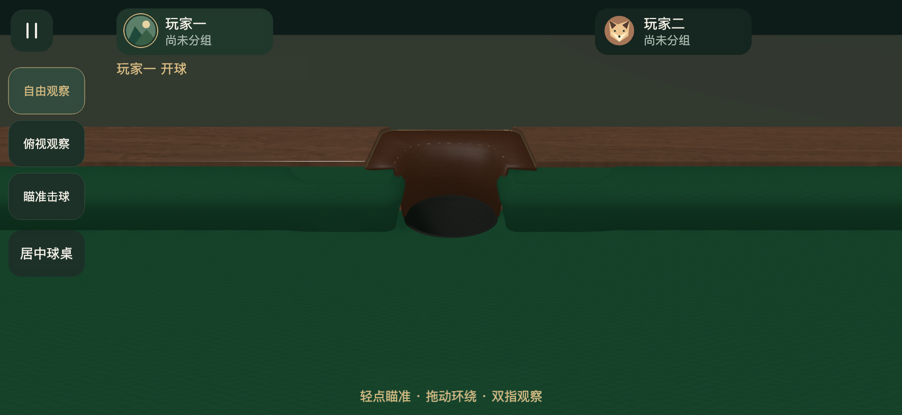

# 袋口前缘曲线修正

2026-11-09。接入阶段把直线落袋边界作为台呢切口，导致可见袋口前缘出现横向直边。现采用64点连续闭合轮廓，前缘为圆弧，肩位沿用V8母版局部参数，中央捕获深度沿用现有值。台呢、石板、袋内衬与台面支撑共同使用该轮廓，台呢切口补回0.8mm双段倒角。

角袋/中袋候选净口85/82mm、胶边碰撞鼻线和V8母版造型继续作为基准。支持查询和首次边界预测改为与曲线开口相交，偏心进袋的支撑边界随轮廓校准。肩位18mm是V8建模局部坐标，实物精确剖面仍按原设计标记为未核验。

296项Node检查、Creator 3.8.8 Web Mobile构建通过。序列化GLB六袋前缘检查通过，最大轮廓偏差约0.243mm；桌裙外片间隙仍约0.934mm。引擎桌体58086个三角形、12个网格，资源和所有.meta UUID核对通过。

浏览器852×393 DPR2与工程预览各通过115项检查，覆盖六袋正中/偏心8mm、0.3m/s及4m/s进入、原尺寸可见下落、开口内下降、最终隐藏、受支撑静止球与无支撑静止球。工程预览保存逐项及下落坐标，浏览器保存工具观察摘要。另通过52项完整触摸回归。驱动为受控初始球位及速度注入和真实引擎帧循环，真实手机与微信按用户约定跳过。

复建与检查命令见技术接入方案，脚本为scripts/check-game-pocket-curves.py及scripts/preview-pocket-curves.js。资产和源码指纹见summary.json。

