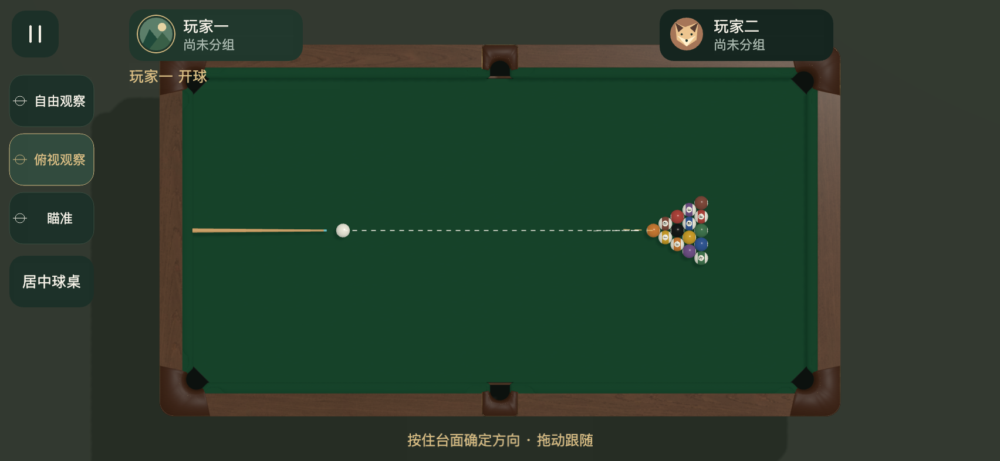
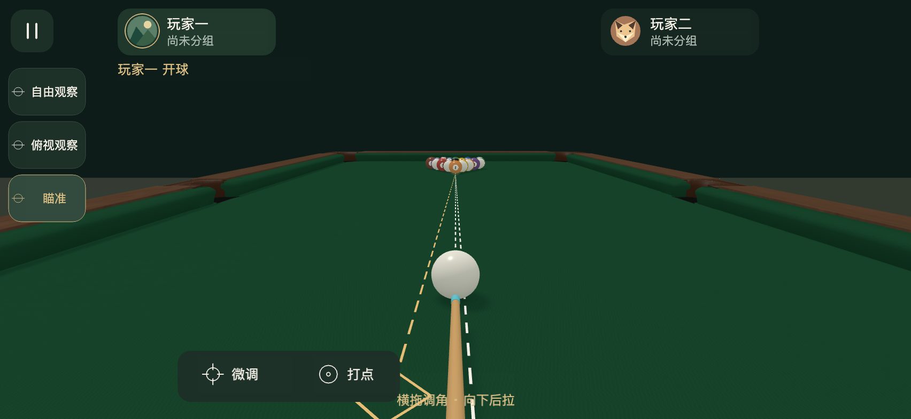
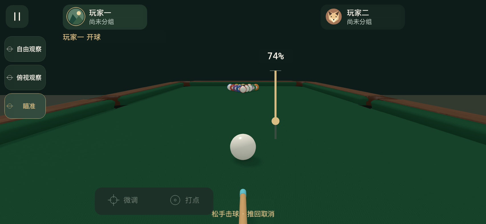
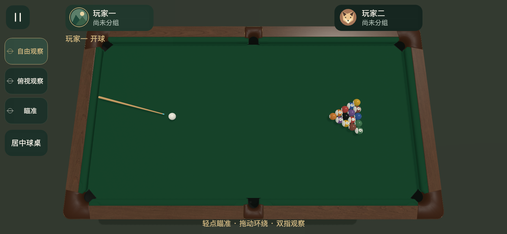

# 三状态触摸与后拉出杆验收

2026-11-08开始，2026-11-09完成。当前源文件SHA256与环境结果见summary.json，可重复运行入口为scripts/preview-touch-modes.js。

- npm run check通过292项，包含原物理、裁判、AI回归与新增手势及前送时序检查。
- Web Mobile三个横屏尺寸各52项，Creator工程预览另52项，驱动为真实canvas上的合成DOM TouchEvent。
- contact-frames.json为组件输入与引擎实际绘制帧记录，10%、50%、100%力度均在触球帧唯一提交，杆头误差小于0.02mm，触球前母球速度为零，送杆淡出经过中间透明度。
- 原生Main启动及画面已复核，项目窗口错误/警告0。系统鼠标释放未能可靠触发，原生系统输入保留为未认证，不能等同真实触屏。
- document-check.json记录PDF页数、副本与SVG结构检查；产品5页和UI/UX前11页已渲染检查，后12页保留已批准V8模型规范。
- 真实手机、微信构建与开发工具依既有用户授权跳过，操作手感待用户体验。

2026-11-09自由观察增加轻点瞄准，新增实际球杆可见朝向、相机保持与松手指向检查，当前各环境52项通过。三档力度触球帧复验通过。
