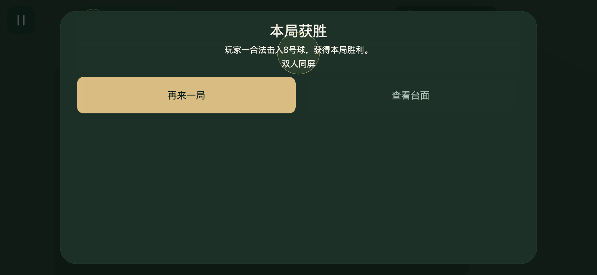
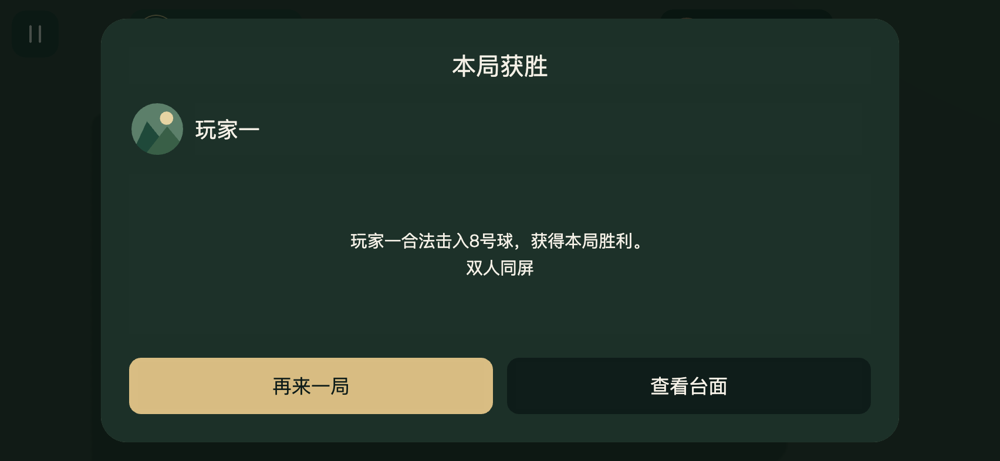
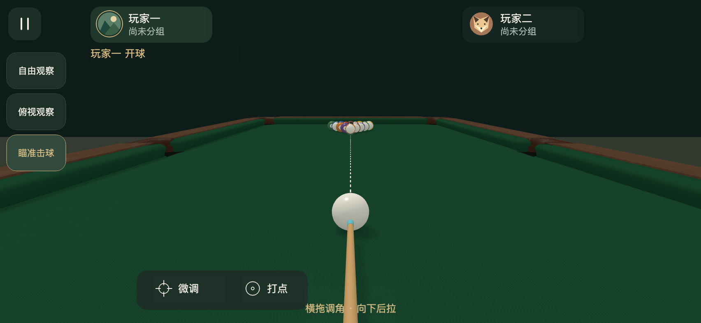

# 模式按钮、结算与辅助线修正

2026-11-09。模式入口使用纯文字居中，显示自由观察、俯视观察、瞄准击球。

横屏结算采用独立布局，标题、胜者头像昵称、判罚正文及两个底部操作区分别排布。合法胜利、长昵称、长判罚文本的实际UI边界均通过无重叠与卡片内包含检查。查看台面、返回结果、查看胜者身份及再来一局通过真实canvas的合成DOM触摸检查。

力度归零时显示白色几何方向虚线和首碰母球轮廓，正力度时沿用实际轨迹预测。等待预测时同样显示方向线，关闭辅助设置时隐藏。重复绘制复用网格，零长度接触保持线路隐藏。

npm run check通过293项，Creator 3.8.8 Web Mobile构建退出36。三横屏与工程预览各21项专项通过，控制台捕获错误为0；852×393另通过52项完整触摸回归。专项脚本为scripts/preview-ui-fixes.js，源文件指纹见summary.json。真实设备及微信沿用用户豁免。

