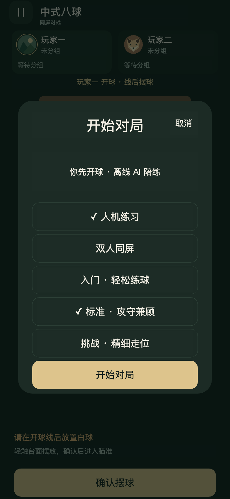

# 离线AI与三档难度验收

2026-10-25。人机练习已接入，自动、浏览器及Creator原生复核通过；用户于2026-10-25体验验证通过，批准提交并推送。保留原双人同屏模式。

- 类型检查与176项Node测试通过。包含独立裁判状态、原球位不变、合法目标/黑八、三档搜索与误差、实际物理合法击球、自由球/线后摆球、确定性与取消、超时选择、存储降级、人手不能代打、锁定参数与后台选择面板保留。原物理、音效与轨迹测试保留。
- Creator 3.8.7资源导入及Web Mobile构建成功，退出码36。原四类声音、双虚线辅助和既有.meta引用保留，无新增远程运行依赖。
- [393参考画幅](browser-393.json)：45项真实DOM触摸人机流程通过；包含人类弱开球→AI接受违规台面→自由球摆放、AI选组进球、独立合法黑八获胜、难度切换/保存、触球前后暂停与不重复提交、切换玩法取消旧工作、取消选择保留原局、后台恢复保留选择面板。
- [320短屏](browser-320.json)及[430大屏](browser-430.json)：各43项核心人机流程通过，所有选择/暂停按钮至少44逻辑像素且不重叠。该两次记录早于最后追加的两项后台选择恢复断言；新恢复逻辑另由Node及393/原生45项覆盖。[旋转验证](orientation.json)确认横屏显示提示，返回竖屏后仍是模式选择、挑战草稿保留且必须点击开始，不绕过选择。
- [原同屏回归](local-regression.json)：81界面、28打点、17输入、28六袋、17音效、16轨迹专项与本机性能通过。音效专项内含35对局、9触球时序与12反馈/降级。
- [Creator原生](creator-native.json)：45人机流程及81界面通过，使用固定3.8.7内部引擎触摸驱动，不是手机触摸。旧预览曾仍加载无AI脚本，已关闭旧实例、重新打开Main并确认新版本后复验，没有引用旧通过结果代替本轮。[原生截图](creator-native.jpg)。
- 浏览器Console error/warn及游戏error/rejection为0；原生本轮游戏error/rejection为0。原生引擎的Gamepad安全上下文提示与DevTools/编辑器缓存通道问题另列，不是裁判或游戏输入异常。

## 三档能力题库

[固定题库](fixtures.json)为7种受控台面×3个确定执行误差种子，每档21次；所有试打使用完整候选上限、相同物理及裁判。它是回归题库，不是玩家胜率或真机耗时。

| 级别 | 候选上限 | 合法杆 | 合法且进球的杆 | 使用高低杆的决策 | 选择一库进攻 |
| --- | ---: | ---: | ---: | ---: | ---: |
| 入门 | 10 | 19/21 | 9/21 | 0 | 0 |
| 标准 | 26 | 19/21 | 10/21 | 12 | 0 |
| 挑战 | 52 | 21/21 | 12/21 | 12 | 3 |

题库保留全部失误和犯规原因，不筛选成功样本。等级整体趋势通过，但样本有限，不能宣称每张台面都严格逐档更强。实际游戏受思考时间上限影响，可能没试完所有候选；例如本机挑战满球台在到时前完成13次试打，仍正常给出命令。

[完整球阵对局](full-match.json)：rackSeed=31、ballSetSeed=42，标准对标准，使用完整候选上限及实际物理/裁判，31杆后正常结束；双方各1次自然犯规。未注入进球、胜负或移动球，包含正常开球、分组、换人、自由球和黑八。不是实战胜率。

## 流畅度与边界

[主动思考性能](performance.json)：本机前台Chromium，挑战AI、完整球阵，思考加瞄准约5.11秒，平均57.5FPS，P95帧间隔29.1ms、最长40.9ms，最长更新31.7ms。约3ms合作式预算不可中途抢占一次物理接触步，不保证每帧硬上限。真实手机及微信按用户既有要求豁免；不能将这些数字推广为手机性能。

难度只改变AI选球、走位/防守评分、搜索范围和最终提交的方向/力度精度；不改变球袋、玩家输入、物理或裁判，也不在运动中修正。已锁定命令在难度变更后仍保留；AI昵称直到下一次真正思考才更新。未来可扩充题库、更多库边解球和更深走位，但本轮没有自动难度、联网模型或职业等级承诺。

复验：`npm run check`、`node scripts/measure-ai.cjs`、`node scripts/measure-ai-match.cjs`。开发预览加载scripts/preview-ai.js后执行previewAI()，在Creator使用inputMode:'engine'。这些工具会重置球局、使用明确标注的受控初始台面，不应在用户正在进行的对局中执行。
