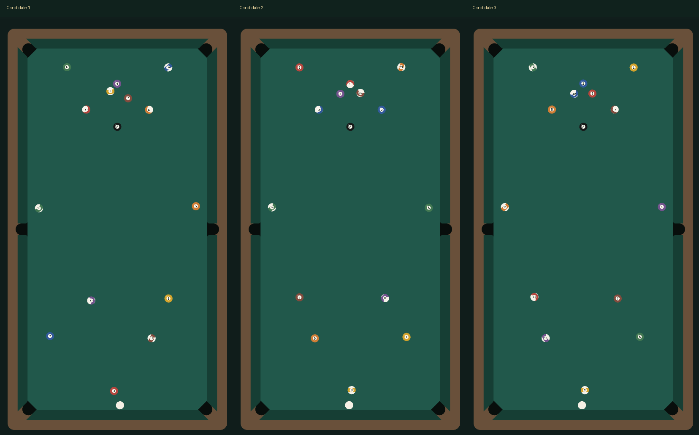

# 开球分布候选：真实性未验收

本机compliant-v3，基线4397155。用户否定network-v2的真实感，本轮不能再把自动检查通过等同于开球真实。候选保留在工作区，尚未提交或推送。

## 实际复现

30个连续球阵种子、轮换5套固定质量参数，默认位置/正中瞄准/中杆/8m/s：

| 指标 | network-v2 | 当前候选 |
| --- | --- | --- |
| 在台目标球上半区占比 | 93.58% | 66.67% |
| 上/下半区平均目标球数 | 10.2 / 0.7 | 10 / 5 |
| 平均目标球进球数 | 4.1 | 0 |
| 球堆端两个角袋同时进球 | 30/30 | 0/30 |
| 原球堆中心17cm平均剩球 | 0.23 | 1 |

左右各12cm、各30次新样本也已记录。角袋分清球堆端(z<0,袋0/3)与开球端(z>0,袋2/5)，避免“底袋”表述含糊。所有数据均来自无终态布置的纯TS轨迹，见[physics.json](physics.json)。这些频率只是特定固定输入的回归统计，不是现实参考频率。

## 未解决的问题

正中30次均无进球，不能据此宣布进球率真实；实际截图母球回退到开球端附近，也需核对实拍。没有真实中式球桌开球轨迹数据集，球间切向摩擦/完整弹性形变/3D仍缺失。当前只能确认上一版固定双角袋和极端分布被移除，不能确认现实还原完成。

三次通过真实Web Mobile页面的DOM触摸确认默认位置、拖动到100%、出杆，停稳后截图。没有调整终态、方向或打点。原图round-1.png至round-3.png及对应裁剪保留，配方和终态见[acceptance.json](acceptance.json)。

## 检查与边界

131项类型/Node检查通过，包含单独两球解析结果、密集网络动量/动能、接触释放、半步长收敛与固定输入分布退化检查。撤销上一轮要求中央球全部离开两球径的目标。

Creator 3.8.7 Web Mobile构建成功退出36；实际浏览器393×852 DPR2：新局/重放28、对局35、打点28、受控整局14、输入17、触球9、六袋28项通过；本机性能/组件计数检查通过，游戏error/rejection为空。第一次探针在场景初始化前启动，被明确拒绝；等场景就绪后完整执行通过，不将诊断启动失败混作游戏异常或通过。

Creator原生GUI本轮未完成；真实手机和微信相关按用户要求跳过。构建后辅助进程有既有Mac rendezvous错误，构建自身退出36；不作为原生GUI通过依据。保持本机源日志，避免提交宿主路径。

## 方法依据与区别

[CMU论文摘要](https://publications.ri.cmu.edu/a-state-transition-diagram-for-simultaneous-collisions-with-application-in-billiard-shooting)说明，多接触的活动阶段、局部弹性能量与刚度比例会影响结果；仅应用整体恢复律不能代替这些过程。[2021年接触力模型论文](https://link.springer.com/article/10.1007/s11071-021-07117-4)通过实验与既有研究验证接触/摩擦模型，并讨论积分精度的影响。两者是方法依据；本候选未完整复现其算法或实验，不借用其验证结论。

本机简化为固定法线、逐接触点线性压缩/阻尼微步；不是完整Hertz模型。8m/s、台呢、库边和进袋阈值均不调节，不设定结果为上下一半、指定进球数或按进球结果筛种子。下一步需要真实轨迹校准，明确比较母球回退、球堆解体过程、各球落点和进球，而不是继续用单一终态指标调参。

运行`node scripts/measure-break-balance.cjs validation/break-balance/physics.json`重做30组前后对照及左右样本；需要4397155历史。
