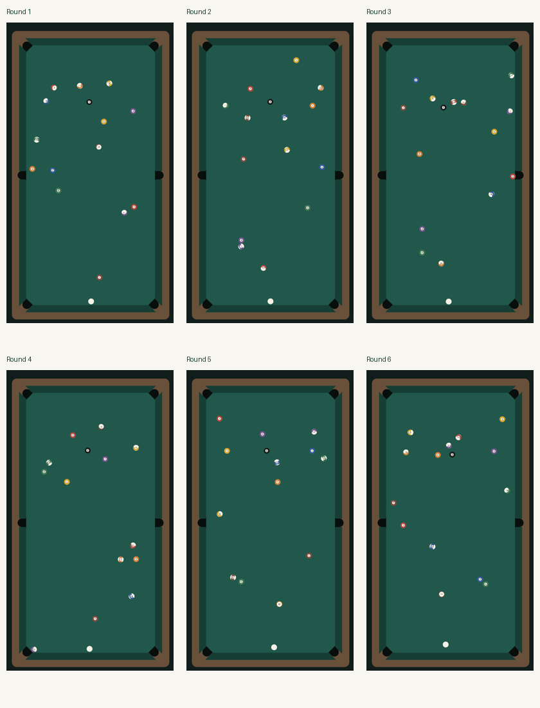
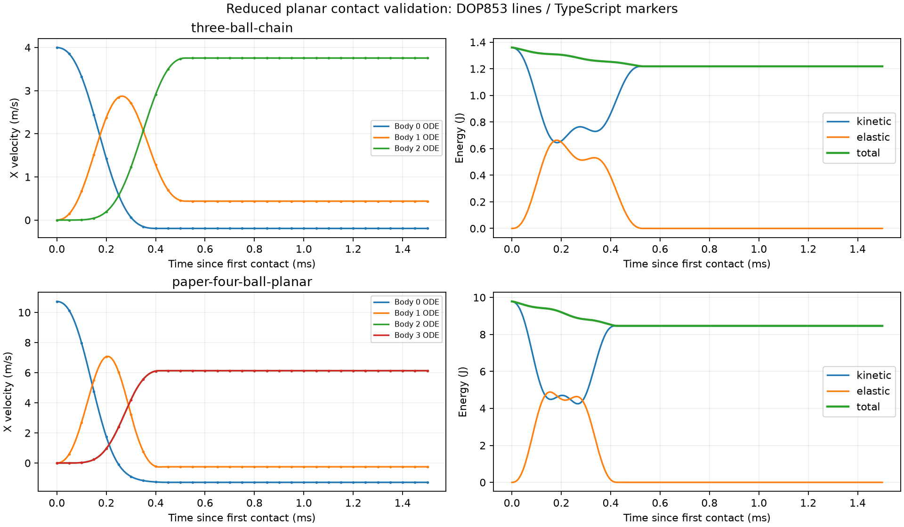

# 开球物理校准验收：hertz-reference-v6

2026-10-24。**数值、本机浏览器与Creator原生预览验证通过，2026-10-24用户体验确认当前版本可接受，批准提交推送。** 用户已否定v2–v4；v5实际出现8颗中心聚球，已撤销，其失败证据保留。这里不再把分布更散直接等同于更真实。

## 先看实际录像

[连续六局复核页面](replays/index.html)包含六段完整、无声的实际Cocos Web Mobile画布录像及停稳原图，另附历史失败种子复验。通过本项目Web Mobile预览服务可访问`/calibration-review/index.html`；正常游戏入口为`/?v=hertz-reference-v6`。录像按正常会话连续产生配置，不筛选、不替换终态，不向运动过程加入随机推力。采集脚本为`scripts/preview-calibration-video.js`，通过DOM触摸确认默认摆球、拉到100%并点击出杆。



| 连续局序 | 中心17cm内目标球 | 平均FPS | P95帧间隔ms | 最长帧间隔ms |
| --- | ---: | ---: | ---: | ---: |
| 1 | 1 | 60.0 | 17.7 | 39.9 |
| 2 | 1 | 60.0 | 17.4 | 38.1 |
| 3 | 3 | 59.7 | 17.3 | 50.4 |
| 4 | 1 | 60.0 | 17.8 | 39.7 |
| 5 | 3 | 59.8 | 17.5 | 51.8 |
| 6 | 4 | 59.8 | 17.7 | 55.8 |

第6局留4颗的样本同样保留。上述中心计数是诊断，不是现实世界的目标分布。另一次录制预检曾出现397.7ms最长帧；同配置不录制复验约60.1FPS、P95 17.4ms、最长47.8ms，不隐瞒该异常，也未为录制降低物理精度。所有正式录像均可解码为786×1704 VP9视频；另经无损重封装补齐时长元数据以便拖动播放，编码帧未改动，文件信息见video-files.json；视频约30fps采样，表内为实际引擎绘制帧数据，二者含义不同。

## P0–P1：参考、接触与能量

- [参考配置](reference-fixtures.json)：半径28.575mm、质量170g、E=3.8GPa、ν=0.375。材料和四球初始条件来自[多球动力学论文](https://link.springer.com/article/10.1007/s11071-021-07117-4)的表1–3；**只使用其可追溯输入**，并未复现原论文完整三维算法或输出曲线，`publishedOutputCurve`明确为空。
- 法向力采用Hertz材料刚度与[官方LAMMPS文档](https://docs.lammps.org/pair_granular.html)描述的恢复系数阻尼形式，单向非负力；不是论文的Lankarani–Nikravesh阻尼。没有引入LAMMPS或通用物理运行库。
- 阻尼比例仅由孤立两球4m/s正碰拟合，再用不同速度/质量比交叉检验；不拟合开球散布或进球率。24个解析对照最大归一化速度误差约3.4e-7，动量误差低于1e-6。[两球与滚动切球结果](isolated.json)。理想刚体切球公式另用刚性极限验证，不把有限弹性误差混同为积分误差。
- `BilliardsContact`保存实际球心压缩量，跨外层帧继续释放；力同时计算，2µs接触微步推进，法线随球心变化；微小切向摩擦转移侧旋，以压缩后接触中点力臂保持平面总角动量。无接触自由飞行直接推进到下一球球/胶边/落袋事件。
- 独立Python/NumPy方程用SciPy DOP853（rtol=2e-11、atol=1e-13、最大1µs）生成三球链/四球参考，再与TS 2µs、1µs结果比较。它验证同一公开简化模型的独立数值求解，**不是作者实验曲线或实测球桌**。

| 基准 | 2µs最大归一化速度误差 | 最大位置误差 | 总能量超额 | 线动量相对误差 |
| --- | ---: | ---: | ---: | ---: |
| 三球链 | 0.0239% | 0.494µm | 0 | 1.15e-15 |
| 四球平面配置 | 0.0651% | 3.10µm | 0 | 1.59e-15 |

步长减半后误差进一步下降。`numerical.json`保存逐时刻平移/侧旋、动能/弹性储能、动量、接触起始，以及每次实际半步施力、积分权重和成对冲量；两端力记录可重建积分。离开接触后零力终止以压缩回零和速度记录检查。有摩擦斜碰另验角动量和能量耗散。达到迭代预算会报错，不静默丢时间。全桌胶边/球球耦合另验机械能不得增加0.1%。



## P2：全桌受控样本

[breaks.json](breaks.json)保存30个连续种子/5组固定质量profile，以及左右偏置各12cm×3档速度×10个种子的60局附加样本、3个历史失败配置和理想无公差控制。包含逐球轨迹、按发生顺序排列的触球/触库/落袋事件、落位和分布。事件时间窗为外层240Hz帧，不能当作微秒级接触时刻；短接触的精确施力时刻见独立基准。

- 30局均有限、台内并最终停稳；1mm精度下有30种不同落位，镜像差均值16.54cm。
- 在台目标球上/下半区均值8.87/5.83；平均目标球进袋0.30颗，球堆端双角袋同时进球为0；中心计数均值2.13。**均为本次固定样本统计，不是实物验收指标或真实进球率。**
- 60局偏置/力度样本全部数值安全并停稳；保留弱杆聚球，不对每局指定进球数或上下分配。
- 3个历史失败种子中心分别留2、1、1颗。最严重的1955789292/3294803093另做实际DOM触摸录像，中心1颗、正常进入ready，未隐藏违规面板。
- 无质量差/无公差的理想全桌控制镜像误差1.36e-8m；不靠数组顺序破坏理想对称。默认与最大公差各1000个种子的合法性、位移有界、无重叠等检查纳入Node测试。

## P3：运行回归与边界

- `npm run check`：类型检查和145项Node测试通过。Creator 3.8.7 CLI导入/Web Mobile开发构建成功；CLI不能代替原生GUI预览。
- [浏览器报告](browser-checks.json)：393×852 DPR2、Cocos 3.8.7实际帧循环。35对局、28打点、14受控整局、17输入、28六袋、81界面、12反馈/减少动态、9触球时序全部通过；另做新局/重放28项专项。受控球局/袋口测试显式布置初始状态，不与自然开球录像混用。
- 无新增页面error/unhandledrejection、Console error/warn。实际击球仍在逻辑220ms图标触球帧且唯一提交，重复点击与触球前后暂停通过。
- 空闲/放大约60FPS，P95为17.6/17.6ms，反复开关面板前后组件数365不变；只代表本机Chromium。
- **Creator原生GUI通过**：[原生报告](creator-native.json)与[实际截图](creator-native.jpg)。完全退出同名进程后，直接以工程路径启动Creator、打开Main并Play，确认3.8.7 / hertz-reference-v6，28开球/35对局/28打点/9时序/81界面共181项引擎触摸检查通过，游戏error/rejection为空。预览设备配置393×852，但嵌入WebView实际179×390、DPR2，覆盖缩小预览适配；这不是硬件触摸认证。启动时另有引擎Gamepad secure-context警告及DevTools Autofill协议提示，与游戏错误分开记录。真机、微信构建/工具/设备继续按用户要求豁免。
- **用户体验验收通过**：2026-10-24用户明确确认“这一版可以”，批准提交推送。没有实拍测量数据，完整3D抬升/跳球、真实胶边/皮口形变、厂家袋型与本项目球桌手感仍未标定。

## 参数和复验

游戏参考profile采用[pooltool官方参数文档](https://pooltool.readthedocs.io/en/stable/autoapi/pooltool/index.html)：球球恢复0.95、摩擦0.05；胶边恢复0.85、摩擦0.2；滑动摩擦0.2、滚动摩擦0.01。取g=9.81，对应1.962/0.0981m/s²；侧旋减速度3.814rad/s²。材料来自另一公开算例，**两者组合属于项目参考profile，不是同一实物球桌的完整测量**。打点仍受同一出杆能量预算约束。旧dt=0无时间推进碰撞修复接口仅兼容诊断测试，游戏正时间步不走该路径。

```
npm run check
node scripts/calibrate-contacts.cjs
python3 -m venv tmp/recalibration/venv
tmp/recalibration/venv/bin/pip install -r scripts/requirements-calibration.txt
tmp/recalibration/venv/bin/python scripts/reference-contact-ode.py
node scripts/verify-contact-reference.cjs
tmp/recalibration/venv/bin/python scripts/plot-contact-calibration.py
node scripts/measure-calibrated-breaks.cjs
```

Python工具仅供离线校准；游戏没有新增Python/SciPy运行依赖。协议版本与存储键分别为hertz-reference-v6 / eight-club.racks.v6；不同版本配方拒绝，不能拿旧配方标签复现新物理。
