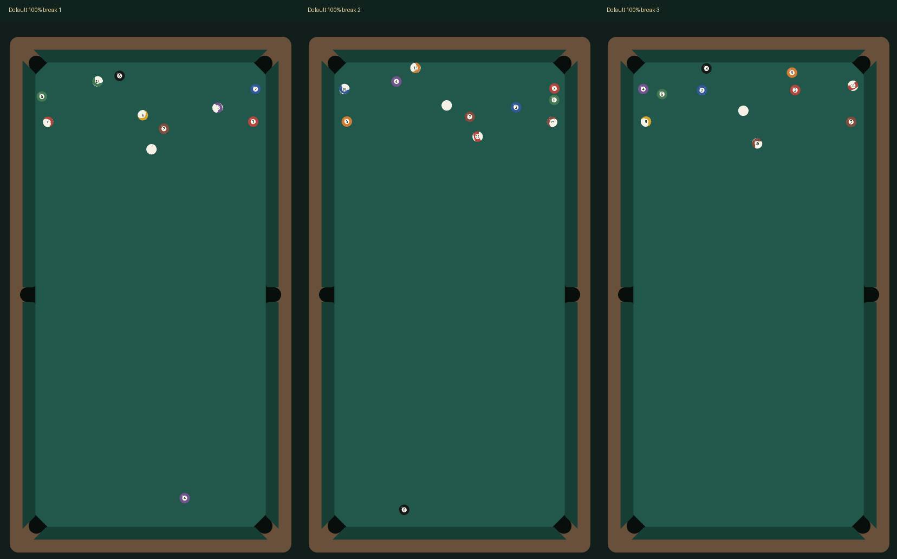

# 中央球堆滞留修复（2026-10-23）

用户反馈：默认位置、默认方向、100%开球后，中央四五颗仍紧聚。旧版本77449f6的随机球号和微差没有解决此问题；本轮修复密集接触网络的冲量传递。

[设计约束](../../docs/design/rack-variation.md)；[纯物理前后对照](physics.json)；[当前随机性与复现对照](racks.json)；[实际页面报告](acceptance.json)。

## 实际画面

以下三局均在最新Creator Web Mobile页面，通过DOM触摸确认默认白球位置、将力度拖到100%、点击出杆，等自然停稳后截图。没有调整方向或打点，也没有设置球的终态。原图round-1.png至round-3.png；球桌裁剪table-1.png至table-3.png；具体配方和终态在acceptance.json中。

## 量化结果

同一球组、连续50个合法球阵种子，默认白球(0,0.65)、方向(0,-1)、中杆、8m/s，比较77449f6与network-v2：

| 指标 | 修改前 | 修改后 |
| --- | --- | --- |
| 原球堆中心17cm区域平均剩球 | 4.94 | 0.24 |
| 上述区域最多剩球 | 5 | 1 |
| 原中央四球中最小的运动最大位移 | 0.058cm | 16.10cm |
| 每局终态移开初始位置20cm或进袋的目标球数，取50局最小值 | 9 | 14 |
| 有限数值、外框内、15秒内停稳 | 全部 | 全部 |

中心区域固定为(0,-0.735)半径0.17m，不包含母球；中央四球按初始空间bodyId 2/3/4/8识别，不按随机球号选择。运动最大位移指全过程距离初始位置最远的位置，允许碰库后返回；不是累计路程。验收要求中心最多2颗、四颗内部球都至少移开2球径，全部通过。不是承诺任何开球都清空中心或全桌均匀分布。

## 回归与复现

- `npm run check`：类型检查及130项测试全部通过。包括100组密集不等质量接触网络的动量守恒/动能不增加、双球解析恢复系数、静止/分离网络不产生虚假冲量或事件。
- Creator 3.8.7 Web Mobile开发构建成功，退出码36。
- 393×852 DPR2实际DOM触摸：3次新局+首局重放，36项通过；默认白球/方向/打点不变，真实力度100%，逻辑220ms触球，点击不提前运动；相同配方精确复现。
- 对局35、旋转打点28、受控整局14、异常输入17、触球9、六袋28项通过。受控整局只认证裁判流程，不冒充自然AI比赛。浏览器新增Console错误/警告0。
- 本机普通和放大瞄准性能采样及50次设置往返组件数检查通过，具体帧率见acceptance.json，不推广到手机性能。
- 50种均质换号控制仍为同一几何；微差组50局为50种无编号1mm终态；1224/1225对比的Hausdorff距离≥2cm，全部停稳且同配置精确复现。此指标表示两组中最难匹配点的距离，不是每颗球移动距离。

运行`node scripts/measure-core.cjs validation/core-spread/physics.json`重做前后对照，需要仓库包含77449f6历史。运行`node scripts/measure-racks.cjs validation/core-spread/racks.json`重做当前随机性对照。浏览器开发控制台加载preview-racks.js后运行previewRacks()验证新局/复现；preview-core.js的previewCoreBreak()通过实际DOM触摸开一局，并保留自然停稳画面。

## 实现边界

满力8m/s、台呢减速和±0.5%质量差异不变，未加入爆破力、按开球状态额外加速、方向误差、强制散球或按结果筛种子。普通击球共用同一求解器。物理配方升级network-v2，旧版配方明确拒绝，新的本地记录键eight-club.racks.v2在升级时初始化一次球组，此后跨刷新保留。

本轮原生Creator GUI引擎触摸专项未完成，上一轮的调试通道问题尚未解决；CLI构建和实际Web Mobile页面验证分别通过，不以旧原生证据替代本轮。真实手机与所有微信相关验证按用户要求跳过。模型仍为XZ平面离散接触近似，不包含完整弹性形变、球间切向摩擦、跳球与飞台，也不声称跨环境确定性。
