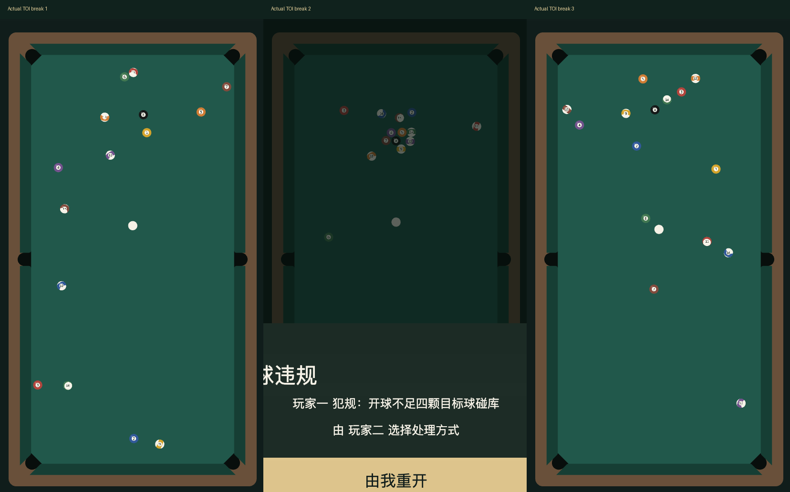

# 被拒绝的碰撞时序实验（2026-10-24）

**未通过实际验收，不发布。** v5实验代码已从运行目录撤下，Web Mobile预览恢复v4。135项自动检查通过不等于真实开球通过。

实验改为按球间预测碰撞时刻推进，只对实际同时接触的球做局部求解；同一微步的冲量先计算后统一更新。公差维持0.25mm，未增加随机力或更改瞄准/力度。理想无公差、均质控制组保留对称性。

[30局纯物理统计](physics.json)的镜像误差8.68→23.81cm，但中心平均剩球1.87→2.9、上半区占比66.7%→74.5%，说明单看对称性数字仍会掩盖退化。

## 实际失败证据

三次均通过真实Web Mobile页面合成DOM触摸确认默认位置、拖动100%、点击出杆，并等自然停稳；没有重排终态或筛掉第二局。第二次8颗目标球留在球堆中心附近，裁判判开球不足四颗碰库。第三次等下一局重新生成，不为替换失败截图。

[完整页面报告](acceptance.json)包含三个配方、逐帧约50ms采样的实际运动轨迹、终态和错误收集，releaseAccepted=false。原图round-1.png至round-3.png、裁剪table-1.png至table-3.png均保留。第二局的遮罩来自真实裁判弹层，未为了截图修改UI。

失败配方：版本rack-toi-v5，rackSeed=1955789292，ballSetSeed=3294803093，massVariation=0.005，positionToleranceM=0.00025。此版本仅在experimental-source中保存，当前运行版本拒绝载入它；不要直接以v4重放并宣称相同结果。

## 源码与检查范围

experimental-source内为实验当时的四个纯TS模块，位于assets之外，不会被Creator导入运行。可单独转译后用记录的初始条件重放，不需要Cocos。

实验类型/Node共135项、Web Mobile构建和实际浏览器新局36/对局35/打点28/受控整局14/输入17/触球9/六袋28项通过，error/rejection为空。这些结果仍未覆盖失败的观感和中心聚球，故整体拒绝。

另试验了逐球独立摆放、非线性力、有限接触时间及切向摩擦原型；均没有得到可交付结果，仅留在忽略的本机tmp目录中。运行代码没有增加这些参数或按结果过滤种子。

下一步见[物理重新校准计划](../../docs/technical/physics-recalibration-plan.md)。原生GUI本轮未完成，真机与微信仍按用户要求跳过。候选修改未提交推送。
