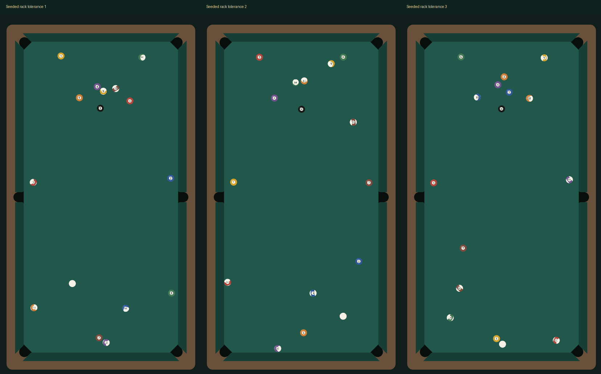

# 微小摆球公差候选（rack-tolerance-v4）

用户已允许微小初始摆放差异，替代“不改变初始球位”的旧限制。当前只更新本机验证页，整体真实感未验收，未提交推送。

默认球心偏移上限0.25mm，开发配方可设0–0.5mm。顶球与母球固定，后四排小幅横移并纵向补偿，排内距离保持原球径+10微米、与底库平行，最近父球也保持原距离，确保无重叠且视觉上紧密。公差是本项目仿真参数，不是现实器材公差标准。瞄准/力度/打点/8m/s预算不变，物理途中没有取随机数或额外推力。

## 成对对照

[纯物理报告](physics.json)：同一求解器、同一球组、30个连续rackSeed、默认位置/正中/中杆/100%，仅比较公差0与默认公差；没有筛选种子。

| 指标 | 公差0 | 公差0.25mm |
| --- | --- | --- |
| 平均镜像误差 | 3.28cm | 8.68cm |
| 上/下半区在台目标球平均数 | 10 / 5 | 10 / 5 |
| 球堆中心17cm平均剩球 | 1 | 1.87 |
| 同时进球堆端两个角袋 | 0/30 | 0/30 |
| 平均进球 | 0 | 0 |
| 无编号1mm终态种类 | 30 | 30 |
| 有限数值、外框内且停稳 | 全部 | 全部 |

镜像误差：将每颗在台目标球沿台桌纵轴反射，找原球位集合最近点距离，再对球和球局取平均。误差越大表示越不呈左右镜像，不代表每颗球移动8.68cm，也不代表真实球桌吻合度。

尝试过独立球心扰动和不同幅度。独立扰动会让所有相邻间隙一起增大，增加中心聚球；选用受约束的排移来保留紧邻关系。没有按单局进球、对称程度或分布筛选配方。

## 实际页面

[浏览器报告](acceptance.json)与round-1.png至round-3.png原图保留。通过真实Web Mobile页面合成DOM触摸确认默认摆球、拖到100%、点击出杆，等自然停稳后截图；没有写入终态或更改方向。table-1.png至table-3.png为同一区域裁剪。

134项类型/Node检查通过：1000种子在默认与最大幅度分别验证边界、无重叠、顶球/母球固定、紧邻和合法球号；同配置精确重放，出杆不取随机数；均质换号控制明确使用massVariation=0、positionToleranceM=0；重摆保留公差profile。新增16对固定种子的镜像误差回归，非真实数据标定。

Creator 3.8.7 Web Mobile构建退出36。393×852 DPR2实际DOM检查：3新局+首局重放36、对局35、旋转打点28、受控整局14、输入17、触球9、六袋28通过，error/rejection为空；本机普通/放大瞄准及设置往返组件计数检查通过。原生Creator GUI本轮未完成；真实手机和微信继续用户豁免。构建后仍有既有窗口恢复缓存JSON错误，不作为游戏异常或GUI通过证据。

## 复现与边界

运行`npm run check`和`node scripts/measure-rack-tolerance.cjs validation/rack-tolerance/physics.json`。配方包含version/rackSeed/ballSetSeed/massVariation/positionToleranceM，本机键eight-club.racks.v4，旧物理版本拒绝重放。新局改变球阵，暂停/设置不改变，裁判重摆沿用当前幅度。

当前正中样本仍无进球；母球回退和完整接触模型未用实拍标定。只能确认对称性减弱及输入精度保留，不能声称整体开球真实感已解决。模型仍是固定法线的局部线性压缩近似，非完整Hertz/球间切向摩擦/3D模型。
