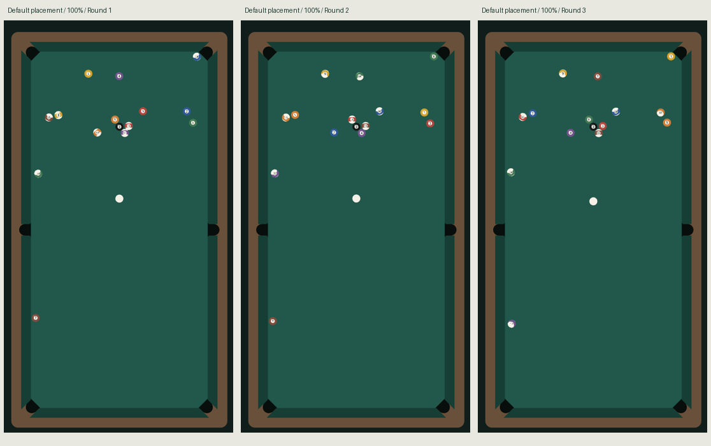

# 合法随机开球验收（2026-10-23）

代码基线3e379e1之后的mass-slot-v1修订。[方案](../../docs/design/rack-variation.md)、[完整运行报告](acceptance.json)、[纯物理报告](pure-racks.json)。

## 实际效果

三局均通过实际Web Mobile页面的合成DOM触摸：默认白球位置、默认方向、中杆、100%力度。自然停稳后截图，没有布置终态或挑选种子。球号和几何位置均有变化，变化幅度由固定球体微差产生，不保证每局大幅改变所有球位。

原图round-1.png至round-3.png；对应球桌裁剪table-1.png至table-3.png。配置和终态在acceptance.json的actualScreenshotCases中。

## 自动验收

- 类型检查与126项Node测试全部通过，保留旧规则/旋转/触球时序回归。Creator 3.8.7 Web Mobile构建成功退出36。
- 100个种子验证合法排列、紧密摆球；目标球质量固定且不超过±0.5%，母球质量1、方向/力度/打点不变。
- 均质控制50种球号排列：忽略号码只有一种几何终态，按物理身份逐值相同。反转输入数组也不改变结果，排除球号排序制造的伪变化。
- 同一球组、50种合法摆球：1mm精度产生50种无编号几何终态。1225组两两对比中1167组（95.27%）无编号位置集的Hausdorff距离至少2cm；该指标表示两组中最难匹配的点距离，不是每颗球都移动2cm。平均15.76cm，最小0.72cm。全部有限、在外框内且停稳，最长4.155秒仿真时间。
- 相同配方、相同输入精确重现；步进期间不调用随机数。校验不按进球或散球结果筛选种子。
- 浏览器393×852 DPR2：5局新开球及首局重放，52项通过。320×568 DPR1、430×932 DPR3各2局新开球加重放，各28项；DPR3引擎渲染仍上限2。
- 真实页面重载后球组和质量保持、新局种子推进、记录上限32；本地存储损坏/不可用时的内存降级另有Node测试。
- 本轮实际生产球阵回归：对局35、打点28、完整受控球局14、输入17、触球9、六袋28项通过。受控整局用于流程验证，不冒充自然AI比赛。
- DOM点击不立即运动；逻辑220ms触球时唯一提交，首次速度采样约7.9925m/s。游戏error/unhandledrejection和浏览器Console新增错误/警告均为0。

本机Chromium普通瞄准/放大瞄准各3秒约60FPS，P95分别18.6/18.0ms；50次设置往返组件365不增长。仅为本机性能抽样。

## 复现

运行`npm run check`。运行`node scripts/measure-racks.cjs validation/racks/pure-racks.json`重做50+50局对照。

浏览器加载最新Web Mobile构建，在开发控制台加载scripts/preview-racks.js，再运行`await previewRacks()`。默认5局新局加1局重放。开发探针会临时关闭声音与振动，结束后恢复设置；不是面向玩家的回放功能。scripts/preview-power.js使用固定均质配方来隔离力度标定，随机开球由本专项覆盖。

## 验证边界

本轮Creator原生GUI调试连接反复出现Channel closed / IPC message lost，尝试重载与重启仍未完成新专项的引擎触摸验证，明确记为阻塞，不以旧原生结果代替。CLI构建成功与浏览器实际运行分别已通过。

真实手机、微信小游戏构建/工具/真机按用户要求跳过。精确重现仅认证同版本和同运行环境；尚未认证跨平台确定性、联机权威同步，也没有完整回放产品。
