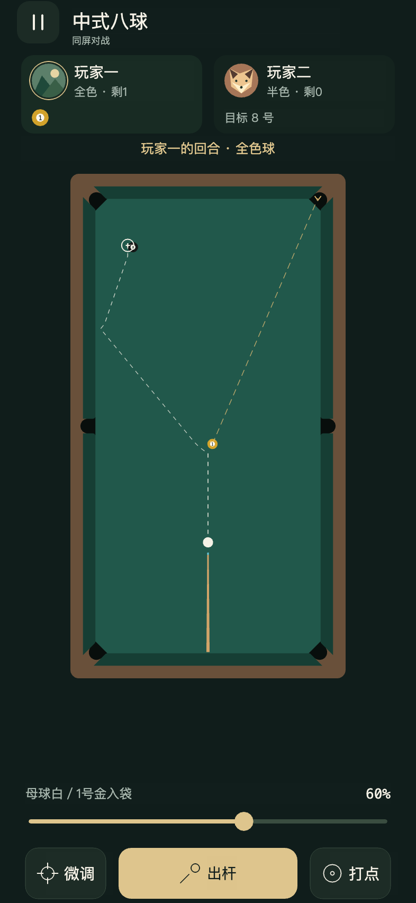

# 白色母球轨迹与金色目标球轨迹验收

2026-10-25。实现已完成，本机自动/浏览器/Creator原生验证通过，2026-10-25用户已验证双虚线版本通过，批准提交并推送。

- 159项Node测试和类型检查通过。新增精确固定步终点比对、跟/缩杆/侧塞、碰库后首碰、目标进袋/母球落袋、弱杆未到目标、分帧与连续计算一致、输入失效、原球局不变，以及折线压缩测试。
- Creator 3.8.7导入/Web Mobile构建成功，退出码36。未改变物理、球阵、音效和裁判，只在复制的全桌状态上预演。
- [393×852 DPR2](browser-393.json)：轨迹16、界面81、打点28、输入17、六袋28、声音17项全部通过；声音专项内含35对局、9触球、12反馈与降级。受控切球的实际两球终点与预测坐标相同，误差0；完整轨迹同时包含碰库和后续碰球。
- [320×568](browser-320.json)、[430×932](browser-430.json)：各16轨迹、17输入、9触球通过。斜向低杆右塞说明与颜色说明在220/322逻辑像素宽的标题区内完整显示。截图见cut-320.png、cut-430.png。
- [Creator原生](creator-native.json)：通过原生内部引擎触摸驱动复验16轨迹、17声音与81界面；声音专项又含实际对局、触球与降级。实际WebView为317×688 DPR2，设备预设393×852，不能据此声称手机真机。原生切球端点误差同为0，约354ms得到完整预测。[原生画面](creator-native.jpg)。
- 基准浏览器受控切球预测为数百毫秒，第一轮约346ms；实时更新期间不修改实际球位，改力度、确认新打点及改方向立即移除旧预测。射击准备阶段不提前移动真球，暂停/开关正确隐藏辅助。
- 本机空闲/放大平均约59.4/60.2FPS，P95均25.2ms；反复切面板前后374组件一致。该数值来自同机同时运行Creator的Chromium，不代表手机性能。合作式2ms预测预算不能抢占一个物理步，不承诺硬实时帧上限。
- 浏览器Console error/warn、页面error/rejection为0；原生本次游戏error/rejection为0。编辑器历史错误计数8→8未增加，旧Channel closed、引擎Gamepad安全上下文提示与本次游戏验证分开记录。

显示范围：母球白色虚线、首碰目标球金色虚线；其余球参与物理但不绘制各自轨迹。圆形十字和菱形表示最终静止，入袋用箭头；计算中或预算用尽时不画终点圈。已进袋结果是物理落袋位置，不包含裁判之后的摆球或开球重置8号。沿用当前XZ旋转/胶边/袋口代理模型，不能推广为实物球桌测量；真实手机及微信按用户要求豁免。

## 目标球虚线修订

2026-10-25按用户要求，将金色目标球线改为6px实段/4px间隔的虚线；母球仍为4px实段/4px间隔的白色虚线。159项Node与类型检查、Web Mobile构建通过，16项浏览器轨迹专项再次通过。实际Graphics记录到26段金色线段，最长6px，页面错误0。新结果见target-dashed-check.json及target-dashed.png。此前原生及其它截图属于完整预测功能的上一线型阶段；本次只改绘制样式，未重新执行原生专项。
